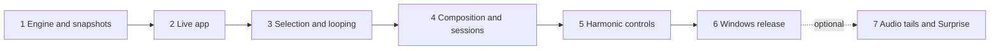

# Glittering Stars delivery roadmap

Status: required M1–M6 implemented and qualified; actual evidence under docs/validation. Prepared 2026-10-28 against repository baseline `57c3dc1`.

Read [SPECIFICATION.md](SPECIFICATION.md) for behavior and [ORCHESTRATOR_HANDOFF.md](ORCHESTRATOR_HANDOFF.md) for execution and validation ownership. Existing CLI functionality remains preserved. Required desktop milestones1–6 are complete; actual evidence is under docs/validation.

## Release sequence

| Milestone | User-visible result | Depends on | Status |
|---|---|---|---|
| [1 — Engine and state foundation](MILESTONE_1.md) | CLI remains usable; state can be safely replayed and resumed | Existing CLI | Complete |
| [2 — Live desktop player](MILESTONE_2.md) | Change parameters and control playback without a terminal | 1 | Complete |
| [3 — Select, replay and loop](MILESTONE_3.md) | Catch a passage and loop exactly the selected chords | 2 | Complete |
| [4 — Compose, save and export](MILESTONE_4.md) | Edit/branch from history; restore sessions; export discoveries | 3 | Complete |
| [5 — Musical exploration controls](MILESTONE_5.md) | Whole-chord/pivot modulation, locks, key limits and spacing | 4 | Complete |
| [6 — Windows release qualification](MILESTONE_6.md) | A packaged, tested, documented desktop app | 5 | Complete |
| [7 — Listening-aware experiments](MILESTONE_7.md) | Optional audio-tail timing and bounded Surprise control | 6 + explicit go-ahead | Optional / not started |

M1–M6 are required v1 scope. M7 remains separately scoped. M3 is the first selection-looping preview, not the final app. Do not postpone M3 behind experimental audio capture, synth hosting, visual polish, or unrelated features.

## Work packages and critical decisions

1. **M1:** separate pure music state from MIDI/UI, add stable voice IDs and resumable snapshots, freeze typed command/event contracts, and verify a PySide6 Windows spike. Resolve deployment uncertainty early without spending the whole milestone polishing UI.
2. **M2:** build one responsive worker-driven transport, expose existing parameters with explicit pending/applied states, and keep CLI compatibility.
3. **M3:** prioritize immutable history, accessible range selection, exact looping, no generation/RNG changes during replay, and safe loop replacement at boundaries.
4. **M4:** make material durable and composable. Branch rather than destroy history; session schemas and export must preserve the same events heard in loops.
5. **M5:** extend musical choice after exact replay is trustworthy. Implement whole-chord-fit and pivot policies as different algorithms; locks must remain authoritative during octave-wide modulation.
6. **M6:** validate integrated workflows on Windows, resolve lifecycle/performance defects, and build a distributable that does not depend on the developer environment.
7. **M7:** only after v1, validate audio-source behavior before depending on tail detection, and make Surprise reversible and inspectable.

## Delegation and integration

The orchestrator owns architecture, interface decisions, task boundaries, integration, and final acceptance. Use at most the available subagent slots; with four slots, keep one for the orchestrator and up to three for engine/domain, UI, and independent QA/review. Small documentation tasks can share a slot after implementation work ends.

Assign workers by uncertainty and consequences rather than file size. State restoration, scheduler lifecycle, RNG isolation, modulation/lock interactions, and persistence migrations require high-reasoning review. Mechanical widget wiring, fixtures, and documentation can use a lighter available worker after contracts are fixed. Do not hard-code model names that may be unavailable; follow the active tools' model-override rules. The handoff describes assignment templates and escalation.

Parallel work is allowed behind agreed interfaces: e.g. domain fixtures and shell UI after M1 contracts, or persistence and MIDI export after M3 history models. Dependencies in the table are milestone acceptance gates, not a prohibition on preparatory work. Never parallelize competing edits to the same module or shared schema without an explicit owner. Every implementation task has disjoint file ownership and test obligations.

## Gates and evidence

Each milestone file supplies tasks, acceptance scenarios, required evidence, and handoff artifacts. For each acceptance criterion record a pass/fail/unverified result, the exact command or UI procedure, revision, environment, and evidence path in `docs/validation/MILESTONE_<num>_RESULTS.md` during implementation. These results files are future implementation artifacts; do not create fake green reports in this planning task.

The orchestrator runs integrated checks after merging workers' changes. Worker summaries are inputs, not acceptance evidence. Keep an acceptance matrix linking specification IDs to tests and observed UI/MIDI behavior; maintain it as scope evolves. A green baseline suite cannot substitute for GUI or hardware validation.

At minimum, inspect:

- Pure engine and random-weight semantics, including zero/blocked moves and all-octave changes.
- Note ownership and cleanup under rapid transport commands and port errors.
- No PRNG/history growth in replay/loop; exact pitches, keys, timing and wrap gaps.
- Configuration ordering across live edits and loop overrides.
- Branch/snapshot restoration and real JSON/MIDI round trips.
- Actual Windows UI interaction and at least one loopMIDI→Surge pass.
- Packaged launch without a repo `.venv`, readable DPI scaling, and documented limitations.

## Release and repository policy

Preserve user settings, existing CLI entry points and the current MIDI route. Add separate app launchers and separate dev/runtime dependencies as needed. Never check in virtual environments, build caches, personal sessions, or generated test recordings. Decide which small fixtures and distributable artifacts belong in Git before adding them.

Use scoped local commits when authorized by the implementation task. Push, PR creation, merge and releases follow the user's current repository instructions; this roadmap does not itself authorize remote publishing. This planning delivery does not create a new chat, delegate implementation, install UI packages, or start building the app.

## Risks to resolve with evidence

| Risk | Resolution milestone |
|---|---|
| Sorting pitches loses lock identity | Stable IDs and crossing tests, M1 |
| Worker blocks command delivery during long gaps | Interruptible transport and close/Stop/Panic tests, M2 |
| Exact loops secretly advance generation | Snapshot/PRNG/history isolation tests, M3 |
| Edits invalidate historical futures | Immutable branches and explicit edited snapshots, M4 |
| Multiple modulation policies have ambiguous probabilities | Explicit eligibility, direction choice, one-roll rules and fixtures, M5 |
| Locks conflict with octave-wide modulation | Reject entire modulation; never partially move octave doublings, M5 |
| Save or timeline rendering delays note-off | Consistent immutable snapshots, virtualized models, stress evidence, M6 |
| Audio capture hears the wrong application | Visible source/meter and fallback; optional M7 only |

No calendar estimate is promised until the M1 spike and state contract have been validated. Re-estimate from measured progress, preserving the acceptance scope above.
